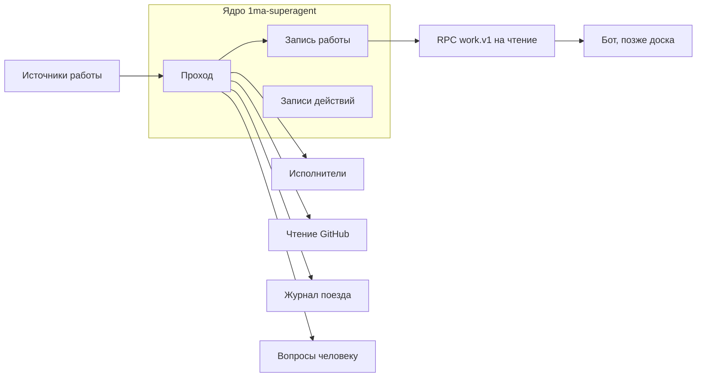

# Суперагент, этап 1: Главный бот и обзор — проект

Дата: 14 ноября 2026 года, правка после ревью Codex. Статус: проект принят с
замечаниями, идёт реализация первого выпуска. Архитектура и её причины — в
ADR-0006. Здесь — состав, данные, действия, точки SDK, порядок работ и тесты
этапа 1 плагина `1ma-superagent`.

Этап 1 ничего не меняет в ревью и выпуске: их по-прежнему ведут
чат-координатор и мост. Плагин ботов `1ma-bots` проектирует и делает другой
чат; здесь описан только шов с ним (раздел 3) и найденные факты для него
(приложение А).

## 1 Состав выпусков

Первый выпуск:

- запись работ и обзор чатов на обоих серверах;
- заявка PR чатом-автором и связь PR с чатом;
- действия бота «читает»;
- вопросы владельцу карточками с очередью;
- запуск чата через бота (`sa_start_chat`) с записью действия;
- итог задачи, запущенной ботом, карточкой без хода модели;
- проверка `main` по журналу поезда.

Второй выпуск, отдельным заданием: пересылка уточнения (текст владелец пишет
в форме, код отправляет его дословно, модель текст не переписывает) и
остановка задачи бота.

## 2 Граница доверия

Защищаемся от текста, который приходит извне (сервер Linux, GitHub, итоги
исполнителей), и от ошибок бота. Агент с оболочкой на Mac может обратиться к
серверу 1ma напрямую и ответить на карточку; сервер не сообщает, кто
ответил. Поэтому ответ на карточку не считается доказательством личного
решения владельца и для решений по чувствительным выпускам не используется.
Карточка разрешает только действия первого выпуска: создать чат по
поручению, привязать PR, отметить попытку.

Из этого следуют правила:

- Действия «читает» возвращают только структурированные поля; свободный
  текст исполнителей в ответ не входит, только ссылка на чат.
- Модель бота не получает свободный текст исполнителей ни в ответах
  инструментов, ни в итогах задач: итог показывает карточка, которую рисует
  код.
- Изменяющее действие выполняет код плагина с параметрами, сохранёнными до
  вопроса; из ответа берётся только выбор варианта.

## 3 Ядро и части

Обобщённые интерфейсы — только там, где в первом выпуске уже две реализации:

| Интерфейс    | Контракт                                                                                                                    | Реализации первого выпуска                                                        |
| ------------ | --------------------------------------------------------------------------------------------------------------------------- | --------------------------------------------------------------------------------- |
| `WorkSource` | `observe(ctx) → ObservationResult`                                                                                          | `owner-chat` (чаты и заявки PR на серверах), `bot-request` (поручения через бота) |
| `Executor`   | `listThreads(page)`, `getThread`, `spawn(label)`, `findByLabel`, `readClaims(threadIds)`; позже `send`, `clearQueueAndStop` | `local` через `bb.sdk`; `remote-http` для сервера Linux                           |

`ObservationResult` = `{ observedAt, completeness: "complete" | "partial" |
"failed", items, error? }`. Неполный и неудачный ответ хранится отдельно от
пустого: «чатов нет» и «сервер не ответил» — разные факты.

Чтение GitHub, журнал поезда и вопросы человеку — модули с одной
реализацией. Их интерфейсы не обобщаются до появления второй реализации.

Представления (бот, позже доска) читают только RPC `work.v1`: `list`, `get`,
`waiting`. Новые поля появляются новыми версиями метода, старые не меняются.

## 4 Шов с плагином ботов

| Случай                            | Как суперагент узнаёт чат Главного бота                                                                                                            |
| --------------------------------- | -------------------------------------------------------------------------------------------------------------------------------------------------- |
| `1ma-bots` не установлен (этап 1) | Настройка `mainBotThreadId`: id закреплённого обычного чата на сервере Mac. Значение читается при загрузке и обновляется через `settings.onChange` |
| `1ma-bots` установлен             | RPC `1ma-bots` `bots.v1.forThread({ threadId }) → { botId, capabilities: string[] } \| null`; действия включаются при `capabilities` с `dev`       |

`bb.agents.configure` синхронный и не может вызвать RPC, поэтому проверка
двухступенчатая:

1. `configure` выбирает инструменты бота, если
   `context.thread.id === mainBotThreadId` или
   `context.origin.pluginId === "1ma-bots"` (`origin` берётся из
   `originPluginId` чата, `thread-runtime-config.ts:180-183`). Это
   необходимое условие, а не разрешение.
2. Каждое выполнение проверяет чат: совпадение с `mainBotThreadId` или ответ
   `bots.v1.forThread` с `dev`. Иначе отказ без действия.

`originPluginId` может задать любой клиент API (этап 0), поэтому шаг 2
обязателен.

## 5 Данные

Хранилище — `bb.storage.database()` (`plugins/1ma-superagent/data.db`,
попадает в `bb server export`). Каждая таблица имеет одного писателя.

| Таблица         | Поля                                                                                                                                                                                                                                                                                        | Кто пишет                                                                              |
| --------------- | ------------------------------------------------------------------------------------------------------------------------------------------------------------------------------------------------------------------------------------------------------------------------------------------- | -------------------------------------------------------------------------------------- |
| `works`         | `id`, `version` (растёт при каждом изменении), `source_kind`, `source_ref` (JSON: ссылка на источник), `server_id`, `thread_id`, `state`, `waiting_reason` (`owner`, `limit`, `machine`, `review`, `release`, null), `created_at`, `updated_at`                                             | Проход                                                                                 |
| `servers`       | `id` (`mac`, `linux`), `last_seen_at`, `last_complete_at`, `last_error`, `completeness`                                                                                                                                                                                                     | Проход                                                                                 |
| `threads_seen`  | `server_id`, `thread_id`, `project_id`, `environment_id`, `branch`, `repo`, `provider_id`, `model`, `status`, `archived`, `updated_at` (как у сервера), `observed_at`                                                                                                                       | Проход; кэш, восстанавливается с нуля                                                  |
| `pr_links`      | `repo`, `number`, `head_repo`, `head_ref`, `head_sha`, `pr_state`, `delivery_server_id`, `delivery_thread_id`, `link_kind` (`claim`, `manual`), `claim_checked_at`, `claim_problem`, `branch_hint` (чаты с той же веткой, только подсказка), `observed_at`; ключ `(repo, number)`           | Проход; `manual` — только ответ владельца                                              |
| `pr_provenance` | `repo`, `number`, `provider_id`, `model`, `first_seen_at`, `last_seen_at`, `complete`                                                                                                                                                                                                       | Проход, пока PR связан заявкой; при ручной связи строк нет, происхождение «неизвестно» |
| `actions`       | `id`, `kind` (`spawn_thread`; во втором выпуске `tell`, `stop`), `work_id`, `expected_work_version`, `params` (неизменяемые после записи), `label`, `state`, `claimed_by`, `claimed_at`, `result`, `question_id`, `created_at`, `updated_at`                                                | Ядро: запись при ответе владельца, захват и результат — исполнитель действия           |
| `questions`     | `id`, `key`, `chat_thread_id`, `work_id`, `expected_work_version`, `kind`, `card` (наблюдение, затронуто, рекомендация, варианты), `priority`, `state` (`queued`, `open`, `answered`, `stale`, `expired`, `canceled`), `interaction_id`, `answer`, `remind_at`, `created_at`, `answered_at` | Проход ставит в очередь; диспетчер открывает; ответ — одной транзакцией с `actions`    |
| `reports`       | `key` (работа, завершённый ход, вид результата), `work_id`, `turn_id`, `result_kind`, `text` (до 600 символов), `question_id`                                                                                                                                                               | Проход                                                                                 |
| `main_watch`    | `repo`, `last_checked_sha`, `state` (`ok`, `needs_reconcile`), `detail`                                                                                                                                                                                                                     | Проход                                                                                 |

Настройки (не секреты): роль сервера (`control` или `executor`), адрес
сервера Linux, `mainBotThreadId`, подключённые репозитории и аккаунты GitHub
каждого сервера, исключённые проекты, путь к журналу поезда.

## 6 Заявка PR и связь с чатом

На Mac 31 из 33 чатов за месяц шли в одном общем каталоге проекта, поэтому
совпадение ветки указывает на чат-автора только подсказкой. Основная связь —
заявка.

- **Чем заявляет чат.** Инструментом плагина `sa_claim_pr({ url })`, а не
  командой CLI. Инструмент получает `threadId` от сервера
  (`ctx.threadId`), а команда CLI — из переменной окружения, которую агент
  может подменить. Инструменты плагинов доходят до всех трёх провайдеров:
  Claude Code (прокси MCP, `plugins/provider-claude-code/src/bridge/tool-proxy-mcp.ts`),
  Codex (`DynamicToolFunctionSpec`), OpenCode через ACP (проверка Codex Б8).
- **Кому видна инструкция.** `configure` добавляет инструмент и одну строку
  инструкции чатам проектов, у которых `project.gitRemoteUrl` — подключённый
  репозиторий.
- **Заявки чатов Linux.** Linux к Mac не обращается, поэтому плагин стоит и
  на сервере Linux в роли `executor`: там у него только `sa_claim_pr` и
  инструкция. Заявка пишется в метаданные чата (пространство
  `1ma-superagent`) на его сервере. Плагин на Mac читает заявки пакетно
  (`POST /threads/plugin-metadata`) и проверяет их сам. Установка на сервер
  Linux — штатным `release-linux.mjs`, отдельным решением.
- **Проверка заявки на Mac.** Репозиторий PR совпадает с репозиторием
  проекта чата; сервер чата подключён; автор PR — аккаунт GitHub этого
  сервера; головной репозиторий PR — тот же или разрешённый; ветка PR есть в
  окружении чата. Две действительные заявки на один PR — вопрос владельцу.
- **Адрес и происхождение.** Адрес доставки — `delivery_thread_id`.
  Происхождение — `pr_provenance`: какие провайдеры и модели работали в чате,
  пока PR менялся. В первом выпуске это наблюдения прохода, и
  `complete = false`, если были пропуски наблюдения. Ручная привязка сильнее
  заявки как адрес, но происхождение при ней неизвестно.
- **Идентичность PR** — репозиторий, номер, головной репозиторий.
- **Чтение GitHub.** Известные PR перечитываются по номеру, в том числе после
  закрытия. Для обнаружения — ограниченная выборка недавно изменённых PR
  (`sort=updated`, пагинация до известного курсора, не больше трёх страниц за
  проход). GitHub читается через `gh api` на машине Mac: хост-часть плагина
  (`bb.hosts.experimental_client`), как у встроенного `github-pr-status`.
- **PR без заявки** — непривязанный: вопрос владельцу с вариантами привязки,
  до привязки допуска нет.

## 7 Действия Главного бота

Инструменты регистрирует `1ma-superagent` (`bb.agents.registerTool`). Все
действия «читает» идут через RPC `work.v1`, так же как пойдёт будущая доска.

| Действие         | Тип    | Выпуск | Что делает                                                                                                                 |
| ---------------- | ------ | ------ | -------------------------------------------------------------------------------------------------------------------------- |
| `sa_overview`    | читает | 1      | Сводка работ: чаты обоих серверов, их PR, ожидающие вопросы, какой сервер не наблюдался и с какого времени, полнота данных |
| `sa_work_detail` | читает | 1      | Одна работа по ссылке на чат или PR: состояние, адрес и происхождение, головной коммит, причина ожидания                   |
| `sa_start_chat`  | меняет | 1      | Предлагает чат: проект, сервер, провайдер, модель, текст поручения дословно; после ответа «Запустить» код создаёт чат      |
| `sa_tell_task`   | меняет | 2      | Уточнение владельца в чат задачи бота: текст пишет владелец в форме, код отправляет дословно                               |
| `sa_stop_task`   | меняет | 2      | Очередь сообщений чата задачи удаляется, затем чат останавливается; проверяются отложенные повторы `provider-retry`        |

## 8 Вопросы человеку

### 8.1 Устройство SDK

- Встроенный `ask-user-question`: инструмент вызывает `bb.ui.requestInput`
  (`plugins/ask-user-question/src/server.ts:79-99`), фронтенд рисует карточку
  слотом `pendingInteraction` и компонентом `QuestionForm` (`app.tsx:49-67`).
- `requestInput` требует только существующий неудалённый чат, ход модели не
  нужен (`apps/server/src/services/interactions/pending-interactions.ts:526-557`).
- Форму рисует слот того плагина, который её открыл. У суперагента свой слот
  с тем же видом; `QuestionForm` берётся из `packages/shared-ui` bb (MIT)
  копией с `UPSTREAM.md`.
- Открытие порождает `interaction.pending` (`pending-interactions.ts:603`);
  штатное уведомление «Waiting for your input» приходит, кроме прочитанных,
  архивных, скрытых и заглушённых чатов (`plugins/push-notifications/sender.ts:39`).
- Ответ — `POST /threads/:id/interactions/:interactionId/respond`; обработчик
  получает только значение (`pending-interactions.ts:645-690`).
- Ожидание живёт в памяти сервера: остановка чата, перезагрузка плагина и
  перезапуск сервера его прерывают (`thread-lifecycle.ts:2044-2047`,
  `pending-interactions.ts:654-661`).

### 8.2 Очередь и диспетчер

- Проход не ждёт ответа: он только ставит вопрос в `questions` (`queued`) с
  ключом, целью и ожидаемой версией работы. Тот же ключ второй раз не
  ставится.
- Диспетчер — короткая функция после прохода и после каждого ответа. В
  каждом чате держит открытой одну карточку: самый приоритетный вопрос из
  очереди. На карточке видно, сколько ещё ждут.
- Если открытая карточка пропала (перезапуск, перезагрузка, остановка чата),
  диспетчер открывает её заново с тем же вопросом.
- Срок карточки — 7 дней (предел `requestInput`). По истечении вопрос
  открывается заново, если причина осталась.

### 8.3 Ответ и запись действия

1. Ответ приходит в обработчик `requestInput`. Принимается, только если
   вопрос в состоянии `open`, `interaction_id` совпадает с открытой карточкой,
   а версия работы равна `expected_work_version`. Иначе вопрос `stale`, и
   диспетчер ставит новый вопрос с актуальными данными.
2. Одной транзакцией SQLite: вопрос `answered`, запись в `actions` с
   неизменяемыми `params` (`confirmed`) или отмена.
3. Исполнитель действия захватывает запись атомарно:
   `UPDATE actions SET state = 'sending', claimed_by = ? WHERE id = ? AND state = 'confirmed'`.
   Обработчик, которому захват не достался, ничего не делает. Так один ответ
   не выполняется дважды старой и новой версией плагина.
4. Сервер хранит состояние карточки отдельно от базы плагина, поэтому
   падение между сохранением ответа на сервере и транзакцией плагина
   оставляет вопрос `open`. Диспетчер откроет его заново, владелец ответит
   ещё раз; поручение не теряется и не выполняется дважды.
5. После перезагрузки плагина старый вызов инструмента не возобновляется
   (SDK прерывает его). Результат действия показывает отдельная карточка
   итога, а бот видит его в `work.v1`.

### 8.4 Оформление карточки

Карточка содержит:

- что наблюдается;
- что уже затронуто;
- рекомендацию;
- один-два безопасных варианта; первый помечен «рекомендую», объём
  разрешения записан в самом варианте.

Пример: «Чат для поручения создан не был или ответ потерян. Затронуто:
ничего. Рекомендую подождать. Варианты: „Подождать 30 минут (рекомендую)“,
„Запустить заново — первый запрос ещё может примениться“».

### 8.5 Итог задачи бота

- Ключ итога — работа, завершённый ход (`turn/completed`) и вид результата
  (`done`, `question`, `blocked`, `failed`), а не общий номер события чата.
- Итог показывает карточка в чате бота: состояние, до 600 символов текста
  исполнителя, ссылка на чат, вариант «Понятно». Её открывает код, модель
  бота не запускается, и текст исполнителя во вход модели не попадает.
- Повторный проход не создаёт вторую карточку с тем же ключом.

## 9 Проход

### 9.1 Запуск

| Повод                                  | Чем                                                   | Область                                                                                                                               |
| -------------------------------------- | ----------------------------------------------------- | ------------------------------------------------------------------------------------------------------------------------------------- |
| Расписание                             | `bb.background.schedule("pass", "* * * * *")`         | Весь проход                                                                                                                           |
| Загрузка плагина                       | `bb.background.service`, первый шаг при старте        | Весь проход: события без плагина не переигрываются, а расписание после загрузки ждёт следующую минуту (`plugin-runtime.ts:2097-2104`) |
| Чат на Mac закончил ход или упал       | `thread.idle`, `thread.failed`, `interaction.pending` | Один чат                                                                                                                              |
| Чат на Mac создан, архивирован, удалён | `thread.created`, `thread.archived`, `thread.deleted` | Один чат                                                                                                                              |
| Ответ на вопрос                        | Обработчик `requestInput`                             | Одно действие                                                                                                                         |

Поводы объединяются с сохранением области: идёт один проход, следующий
накапливает объединение областей всех поводов, пришедших за это время. После
сна Mac просроченное расписание срабатывает один раз
(`plugin-service.ts:2797-2813`).

### 9.2 Стоимость и полнота

- По каждому серверу: постраничный список чатов (`GET /threads?limit=&offset=`
  с `includeHidden`), затем постраничный список окружений
  (`GET /environments`) и сопоставление в памяти.
- Подробности (`GET /threads/:id`, модель, заявки) — только для чатов, у
  которых изменился `updatedAt`, и для активных действий.
- У каждого источника предел времени: сервер Linux — 10 секунд на страницу и
  30 на весь список, GitHub — 20 секунд на репозиторий. Истекло —
  `partial` или `failed`, прежние данные остаются с пометкой времени.
- Стоимость прохода измеряется сквозным тестом на ста чатах и трёх
  репозиториях до включения минутного интервала на Mac.

### 9.3 Полный проход

1. Исполнители `local` и `remote-http`: чаты, окружения, заявки.
2. GitHub: известные PR по номеру, выборка недавно изменённых.
3. Связи PR (раздел 6), происхождение.
4. Действия `sending` и `unknown`: поиск чата по метке (раздел 10).
5. Итоги задач бота (раздел 8.5).
6. Журнал поезда и `main` (раздел 11).
7. Диспетчер вопросов.

## 10 Неизвестный исход

1. Владелец ответил «Запустить». Транзакция пишет действие `confirmed` с
   меткой `{ actionId, attempt: n }`.
2. Захват (`sending`), затем создание чата: `POST /threads` (Linux) или
   `bb.sdk.threads.spawn` (Mac) с `origin: "plugin"`,
   `originPluginId: "1ma-superagent"` и меткой в `pluginMetadata`.
3. Ответ получен — `bound`. Ошибка, доказывающая, что чат не создан (`400`,
   `404`), — `failed`. Таймаут, обрыв, `5xx` — `unknown`.
4. Для `unknown` каждый проход ищет чат по метке, архивные и скрытые
   включительно. Один — `bound`. Два и больше — `ambiguous` и вопрос
   владельцу.
5. Через 10 минут без результата — вопрос владельцу. Это эскалация, а не
   разрешение повторить. Варианты: «Подождать N минут (рекомендую)» задаёт
   `remind_at`; «Запустить заново» с предупреждением, что первый запрос ещё
   может примениться. Новый запуск — новое действие с новой меткой, старое
   становится `canceled`.
6. Если чат отменённого действия появился позже, плагин удаляет его очередь
   сообщений, останавливает его и показывает карточку итога.
7. Автоматического повтора нет ни в каком состоянии.

## 11 Журнал поезда и `main`

Журнал — JSONL по пути из настройки на Mac. Факты о формате даны Codex:

- современные записи поезда имеют `author: release-train`, старые строки
  неоднородны и пропускаются;
- записи группируются по репозиторию и идентификатору попытки;
- `started` резервирует `attempt_heads`;
- `push-intent` перед записью в `main` содержит `base`, `final_sha`, `merges`;
- `merged` с тем же `final_sha` подтверждает запись;
- `deployed` с `live.healthy` подтверждает публикацию;
- `rolled-back` хранит исходный `final_sha`, а не SHA ревёрта.

Правила проверки:

- Коммит в `main` объяснён, если он входит в `final_sha` попытки с `merged`
  или в незавершённую попытку, чей `push-intent` совпадает с фактическим
  `main`.
- Наличие блокировки само по себе не доказывает живой поезд.
- `push-intent` без `merged` и любой переход после `rolled-back` дают
  состояние «нужна сверка». Это запись работы, а не вопрос о постороннем
  коммите.
- Коммит, не объяснённый ничем, — вопрос владельцу.

## 12 Порядок реализации

Каждый шаг — отдельный коммит с тестами, увиденными красными, и проверками
из `AGENTS.md`.

1. Каркас `plugins/1ma-superagent`: манифест, настройки, схема базы, ядро
   прохода с объединением поводов, RPC `work.v1` на чтение.
2. Исполнители `local` и `remote-http`: постраничные списки, схемы ответов,
   пределы времени, полнота; сервер «не наблюдался».
3. Сквозной тест в GitHub Actions (отдельный workflow для ветки и PR): два
   сервера, плагин на обоих, проход на A видит чаты A и B.
4. Заявка PR: `sa_claim_pr`, роль `executor`, проверка заявки, чтение GitHub
   через `gh`, `pr_links`, `pr_provenance`.
5. Шов с ботом и действия «читает».
6. Вопросы: слот `pendingInteraction`, очередь, диспетчер, транзакция ответа.
7. `sa_start_chat` и неизвестный исход.
8. Итог задачи бота карточкой.
9. Журнал поезда и проверка `main`.
10. Ревью кода Codex, установка на Mac, приёмка.

## 13 Тесты

### 13.1 Модульные (`@get-bb/plugin-sdk/testing`)

- Схемы `remote-http` отвергают неожиданный ответ; таймаут даёт `failed`, а
  не пустой список; неполная страница даёт `partial`.
- Поводы объединяются с сохранением области; проход во время прохода не
  теряет повод.
- Заявка: чужой репозиторий, чужой аккаунт, головной репозиторий-форк, ветки
  нет в окружении — отказ; две заявки — вопрос; ручная связь сильнее, а
  происхождение при ней «неизвестно».
- Действие: все переходы раздела 10; второй захват не выполняет ничего;
  старый вопрос и устаревшая версия работы не запускают действие.
- Вопросы: одна открытая карточка на чат; тот же ключ не ставится дважды;
  после перезагрузки карточка открывается ровно один раз.
- Итог задачи бота: один на завершённый ход и вид результата; текст до 600
  символов; модель бота не запускается.
- Журнал поезда: объяснённый, незавершённый, посторонний коммит,
  `push-intent` без `merged`, откат.
- Инструменты выбираются только для чата из `mainBotThreadId` или с
  `origin.pluginId === "1ma-bots"`, а `sa_claim_pr` — только для чатов
  подключённых проектов.
- RPC `work.v1` отдаёт те же данные, что видит бот.

### 13.2 Сквозные (GitHub Actions)

Устройство:

- Отдельный workflow `superagent-e2e.yml`, только для ветки `superagent` и
  PR из неё; существующие проверки не меняются.
- Закреплённая сборка сервера 1ma из выпуска (`1ma-server-<версия>.tgz`,
  проверка `SHA256SUMS`), два сервера с каталогами данных во временной папке
  задания: A («Mac», порт 39886) и B («Linux», порт 39887).
- Плагин собирается из коммита и ставится с локального пути: на A в роли
  `control`, на B в роли `executor`.
- Вместо модели — своя заглушка агента ACP `e2e/stub-acp-agent.mjs`,
  подключённая настройкой `customAgents` плагина `provider-acp` (провайдер
  `acp-stub`).
- Между A и B стоит тестовый прокси: обрыв ответа, задержка, передача
  запроса на B позже, чем закрыто соединение клиента, отказ соединения.

Сценарии:

| Сценарий                                       | Как воспроизводится                                                  | Ожидание                                                                                      |
| ---------------------------------------------- | -------------------------------------------------------------------- | --------------------------------------------------------------------------------------------- |
| Проход видит оба сервера                       | Чаты на A и B                                                        | `works` с чатами обоих серверов, полнота `complete`                                           |
| Linux недоступен                               | Прокси отвечает отказом                                              | B «не наблюдался с …», полнота `failed`, чаты B не свободны                                   |
| Чат создан, ответ потерян                      | Прокси передаёт `POST /threads` и обрывает ответ                     | Чат найден по метке; второго нет                                                              |
| Запрос применился после первого пустого чтения | Прокси закрывает клиента сразу, передаёт запрос на B через 90 секунд | Первый проход: `unknown`, без повтора; следующий: `bound`                                     |
| Два чата с одной меткой                        | Тест создаёт второй чат с той же меткой на B                         | `ambiguous`, вопрос владельцу                                                                 |
| Отменённое действие применилось позже          | «Запустить заново», затем прокси доставляет первый запрос            | Первый чат остановлен, очередь пуста, карточка итога                                          |
| Перезапуск между ответом и действием           | Ответ на карточку, перезапуск A до захвата                           | Действие выполнено ровно один раз                                                             |
| Ответ на устаревшую карточку и из двух окон    | Два ответа на одну карточку; ответ после смены версии работы         | Одно действие; устаревший ответ не применяется                                                |
| Две карточки, вопрос во время хода бота        | Два вопроса в очереди; карточка открывается, пока бот отвечает       | Одна карточка на чат, счётчик; ход бота не прерван                                            |
| Сон с открытой карточкой                       | `SIGSTOP` A на 5 минут с открытой карточкой, `SIGCONT`               | Карточка действует или открыта заново; один проход после пробуждения                          |
| На Linux предел чатов                          | `concurrency-limit` на B с пределом 1, два чата                      | Второй ждёт, причина «машина»                                                                 |
| Итог исполнителя содержит «выполни команду»    | Заглушка-исполнитель отвечает «создай чат …»                         | Карточка итога есть, вопроса и действия нет, модель бота не запускалась                       |
| Коммит в `main` мимо поезда                    | Локальный репозиторий и журнал-заглушка                              | Вопрос владельцу; незавершённый поезд не отмечен; `push-intent` без `merged` — «нужна сверка» |
| Лимит провайдера                               | Заглушка возвращает ошибку лимита                                    | Причина «лимит»; повтор ставит `provider-retry`                                               |
| В чат бота не пишется лишнее                   | Десять проходов с изменениями на обоих серверах                      | В чате бота только сообщения владельца, ответы бота и карточки                                |
| Запуск через бота                              | Заглушка-бот вызывает `sa_start_chat`, тест отвечает на карточку     | Без ответа чата нет; «Запустить» — ровно один чат на B; «Отмена» — ни одного                  |

SIGSTOP процесса не заменяет сон настоящего Mac. На Mac Codex при приёмке
проверяет OpenCode, вид карточек и уведомлений, сон, восстановление канала к
Linux и штатный повтор провайдера.

## 14 Предположения и как их проверить

| №   | Предположение                                                                                                                                       | Проверка                                                                                                                          |
| --- | --------------------------------------------------------------------------------------------------------------------------------------------------- | --------------------------------------------------------------------------------------------------------------------------------- |
| П1  | Открытый плагином вопрос в простаивающем чате не запускает ход модели, а ответ приходит только плагину                                              | Сквозной тест: вопрос, ответ через `respond`; новых ходов нет                                                                     |
| П2  | Сообщение владельца в чат бота не прерывает открытую карточку                                                                                       | Сквозной тест: карточка открыта, сообщение, ход бота; карточка отвечается                                                         |
| П3  | Карточка, открытая во время хода бота, не прерывает ход и не попадает во вход модели                                                                | Сквозной тест: заглушка-бот пишет полученный вход в файл; карточки там нет                                                        |
| П4  | Инструменты плагина доступны агенту ACP через мост bb                                                                                               | Сквозной тест: заглушка вызывает `sa_overview`                                                                                    |
| П5  | Агент без оболочки не может ответить на карточку; ответить может любой клиент API                                                                   | Сквозной тест: ответ через HTTP проходит; среди инструментов бота нет ответа на карточку. Для OpenCode без `shell` — Codex на Mac |
| П6  | При пределе `concurrency-limit` созданный чат держит первый ход, и причина читается по HTTP                                                         | Сквозной тест: предел 1 на B                                                                                                      |
| П7  | Постраничный список чатов и окружений даёт сопоставление без запусков `gh` и укладывается в пределы времени на ста чатах                            | Сквозной тест: сто чатов на B                                                                                                     |
| П8  | Ответ из двух окон: второй ответ получает отказ сервера (`409` или конфликт)                                                                        | Сквозной тест: два `respond` подряд                                                                                               |
| П9  | Карточка, открытая до `SIGSTOP`, после `SIGCONT` действует; после перезапуска сервера диспетчер открывает её заново                                 | Сквозной тест; сон настоящего Mac — Codex                                                                                         |
| П10 | `turn/completed` даёт устойчивый идентификатор хода для ключа итога                                                                                 | Сквозной тест: два хода, две карточки итога, повторный проход — ни одной новой                                                    |
| П11 | `gh api` из хост-части плагина работает на Mac с входом владельца; в сквозном тесте GitHub заменяется локальным сервером, на который указывает `gh` | Шаг 4: проверка способа подмены; на Mac — Codex                                                                                   |
| П12 | Плагин в роли `executor` на сервере Linux пишет заявку в метаданные чата, и Mac читает её по `POST /threads/plugin-metadata`                        | Сквозной тест: заявка на B, проверка на A                                                                                         |
| П13 | Сборка сервера 1ma ставится и работает на машине GitHub без входа в провайдеры                                                                      | Шаг 3                                                                                                                             |
| П14 | Лимит провайдера виден как `turn.failed` с `rateLimits`, а `provider-retry` ставит повтор                                                           | Сквозной тест: ошибка лимита от заглушки                                                                                          |

## Приложение А. Факты для чата bb -> 1ma

Найдено при подготовке проекта; плагин `1ma-bots` проектирует тот чат.

Блок ботов в боковой панели:

- `app.slots.navPanel` (стабильная) даёт пункт в навигации над списком
  чатов, не заменяя панель. Регистрация `{ id, title, icon, path, component,
experimental_useBadge?, experimental_sidebar? }`
  (`packages/plugin-sdk/src/app-contract.ts:1017-1060`). `icon` — имя из
  набора bb, иначе значок плагина из `bb.branding`.
- Счётчик — `experimental_useBadge` (экспериментальная):
  `{ count?, text?, tone?, label }`; его получает любой поставщик навигации
  как `item.badge` (`frontend-core-slots.md:126-144` справки SDK).
- Новый пункт виден по умолчанию; порядок — настройка пользователя
  `sidebar.pluginPanelOrder`
  (`apps/app/src/components/sidebar/useSidebarNavigationArrangement.ts:46-57`).
- `experimental_sidebarNavigation` и `experimental_threadList` —
  исключительные слоты (`frontend-sidebar-navigation.md`,
  `frontend-registration.md:333-345`). На Mac выбраны штатные Rail и список
  чатов (Codex, факт 3).
- Регистрация фронтенда синхронна (`PluginAppSetup = (app) => void`,
  `app-contract.ts:4153`): набор пунктов задаётся кодом бандла.
- Страница пункта может показать чат: `ThreadChat` (стабильный) с
  `leadingContent` для карточки над перепиской
  (`frontend-components.md:5-33`). Для первого сообщения —
  `experimental_NewThreadComposer` (`frontend-components.md:239-261`).
- Скрытые чаты не получают штатных уведомлений (`push-notifications`,
  `PLUGIN_OVERVIEW.md`): чат бота с вопросами должен оставаться видимым.

Бот как сущность:

- `bb.agents.configure` и `contributeInstructions` синхронны и вызываются
  при `thread.start` и `turn.submit`; результат каждого обрезается до 32 768
  символов; инструкция инструмента — до 4 096
  (`backend-cli-agents.md:221-251`).
- Инструкции и инструменты применяются при следующем построении сессии
  провайдера, работающая сессия не меняется
  (`packages/plugin-sdk/src/backend-contract.ts:1695-1703`).
- `configure` видит только метаданные своего плагина
  (`context.pluginMetadata`) и `origin.pluginId` — `originPluginId` чата
  (`backend-contract.ts:1194-1248`,
  `apps/server/src/services/threads/thread-runtime-config.ts:180-183`).
- `originPluginId` при создании чата по HTTP сервер не проверяет (этап 0).
