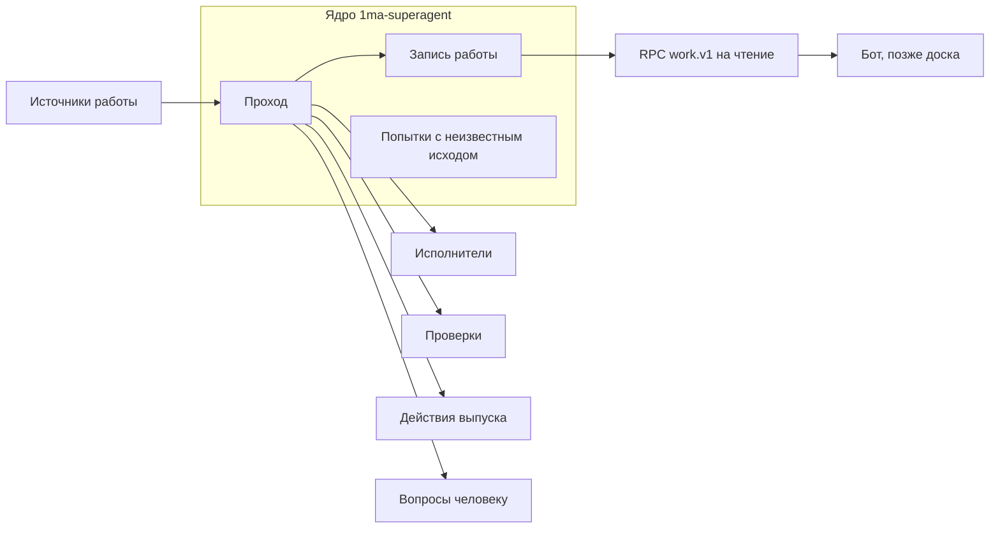

# Суперагент, этап 1: Главный бот и обзор — проект

Дата: 14 ноября 2026 года. Статус: проект на ревью, кода нет. Архитектура и
её причины — в ADR-0006. Здесь — состав, данные, действия, точки SDK,
порядок работ и тесты этапа 1 плагина `1ma-superagent`.

Этап 1 ничего не меняет в ревью и выпуске: их по-прежнему ведут
чат-координатор и мост. Плагин ботов `1ma-bots` проектирует и делает другой
чат; здесь описан только шов с ним (раздел 3) и найденные факты для него
(приложение А).

## 1 Что получает владелец

- Главный бот отвечает о состоянии работ на обоих серверах: чаты, их PR,
  проверки, что ждёт владельца, какой сервер не наблюдался.
- По просьбе бот предлагает запустить чат (проект, сервер, модель, текст
  поручения дословно). В чате бота появляется карточка вопроса; чат
  создаётся только после ответа «Запустить».
- В чат бота попадает только то, что требует владельца (карточки вопросов),
  и то, что он сам запросил (ответы бота, итог задачи, запущенной ботом, до
  600 символов со ссылкой). Отчётов «ничего не изменилось» и хода работы нет.
- Ожидающий вопрос виден в списке чатов и приходит штатным уведомлением.
- Коммит в `main` мимо поезда даёт вопрос владельцу.

## 2 Ядро и подключаемые части

| Часть                | Интерфейс                                                                                          | Этап 1                                                                            | Позже                                        |
| -------------------- | -------------------------------------------------------------------------------------------------- | --------------------------------------------------------------------------------- | -------------------------------------------- |
| Запись работы (ядро) | Таблицы раздела 4; RPC `work.v1.list`, `work.v1.get`, `work.v1.waiting`                            | Работы из чатов и поручений бота                                                  | Без изменений; новые поля — новые версии RPC |
| Проход (ядро)        | `runPass(scope)`: полный или по одной работе                                                       | Расписание, загрузка, события Mac, ответы на вопросы                              | Без изменений                                |
| Попытки (ядро)       | `attempts`: `plan`, `send`, `resolve`                                                              | Создание чата                                                                     | Запрос ревью (этап 2)                        |
| Источники работы     | `WorkSource.observe(ctx) → Observation[]`; у наблюдения стабильный ключ, тип и факты               | `owner-chat`: чаты и PR на серверах; `bot-request`: поручение через бота          | События внешних систем                       |
| Исполнители          | `Executor`: `listThreads`, `getThread`, `spawn(label)`, `findByLabel`, `send`, `clearQueueAndStop` | `local` через `bb.sdk`; `remote-http` для сервера Linux                           | Другие серверы и машины сотрудников          |
| Проверки             | `Check.evaluate(work) → { kind, sha, state, detail }`                                              | `github-pr`: головной коммит, обязательные проверки, сводка Codex — только чтение | Ревью и допуск (этап 2)                      |
| Действия выпуска     | `ReleaseAction.status(repo)`; позже `gate(work)`                                                   | `train-journal`: чтение журнала поезда для проверки `main`                        | Запись допуска (этап 2), слияние PR          |
| Вопросы человеку     | `HumanQuestions.ask({ key, workId, text, options }) → questionId`; ответ приходит в проход         | `bot-chat`: карточка в чате Главного бота                                         | Другие получатели, сотрудники                |

Правила ядра:

- Ядро знает только интерфейсы. Конкретная часть выбирается настройкой и
  регистрируется в одном месте при загрузке плагина.
- Часть не пишет в таблицы ядра напрямую: она возвращает наблюдения и
  результаты, а запись делает проход.
- Представления (бот, позже доска) читают только RPC `work.v1`.

## 3 Шов с плагином ботов

| Случай                            | Как суперагент узнаёт чат Главного бота                                                                                                            |
| --------------------------------- | -------------------------------------------------------------------------------------------------------------------------------------------------- |
| `1ma-bots` не установлен (этап 1) | Настройка `mainBotThreadId`: id закреплённого обычного чата на сервере Mac. Значение читается при загрузке и обновляется через `settings.onChange` |
| `1ma-bots` установлен             | RPC `1ma-bots` `bots.v1.forThread({ threadId }) → { botId, capabilities: string[] } \| null`; действия включаются при `capabilities` с `dev`       |

`bb.agents.configure` синхронный и не может вызвать RPC. Поэтому проверка
двухступенчатая:

1. `configure` выбирает инструменты суперагента, если
   `context.thread.id === mainBotThreadId` или
   `context.origin.pluginId === "1ma-bots"` (`origin` берётся из
   `originPluginId` чата, `thread-runtime-config.ts:180-183`). Это
   необходимое условие, а не разрешение.
2. Каждое выполнение инструмента проверяет чат: совпадение с
   `mainBotThreadId` или ответ `bots.v1.forThread` с `dev`. Иначе отказ без
   действия. Ответ кэшируется на время прохода.

`originPluginId` может задать любой клиент API (этап 0: сервер принял
`1ma-superagent`, которого на нём не было), поэтому шаг 2 обязателен.
Изменяющие действия к тому же требуют ответа владельца.

## 4 Данные

Хранилище — `bb.storage.database()` (SQLite `plugins/1ma-superagent/data.db`,
попадает в `bb server export`).

| Таблица        | Поля                                                                                                                                                                                                                                                                                                     | Кто пишет                                                   |
| -------------- | -------------------------------------------------------------------------------------------------------------------------------------------------------------------------------------------------------------------------------------------------------------------------------------------------------- | ----------------------------------------------------------- |
| `works`        | `id`, `source` (`owner-chat`, `bot-request`), `server_id`, `thread_id`, `repo`, `pr_number`, `head_sha`, `author_provider`, `author_model`, `state`, `waiting_reason` (`owner`, `limit`, `machine`, `review`, `release`, null), `link_source` (`branch`, `label`, `manual`), `observed_at`, `updated_at` | Проход                                                      |
| `servers`      | `id` (`mac`, `linux`), `last_seen_at`, `last_error`, `last_pass_at`                                                                                                                                                                                                                                      | Проход                                                      |
| `threads_seen` | `server_id`, `thread_id`, `project_id`, `environment_id`, `branch`, `repo`, `provider_id`, `model`, `status`, `archived`, `last_event_seq`, `observed_at`                                                                                                                                                | Проход; кэш, восстанавливается с нуля                       |
| `attempts`     | `id`, `label`, `kind` (`spawn_thread`), `work_id`, `request` (подтверждённые параметры), `server_id`, `state` (`planned`, `sent`, `unknown`, `bound`, `ambiguous`, `failed`, `canceled`), `thread_id`, `created_at`, `sent_at`, `resolved_at`                                                            | Ядро: действие после ответа и проход                        |
| `questions`    | `id`, `key`, `work_id`, `kind`, `payload`, `state` (`open`, `answered`, `expired`, `canceled`), `interaction_id`, `answer`, `opened_at`, `answered_at`                                                                                                                                                   | Часть «вопросы человеку»; уникальность `key` среди открытых |
| `bot_reports`  | `work_id`, `reported_seq`, `reported_state`                                                                                                                                                                                                                                                              | Проход: что из итогов задач бота уже отправлено             |
| `main_watch`   | `repo`, `last_checked_sha`                                                                                                                                                                                                                                                                               | Проход                                                      |

Настройки (не секреты): адрес сервера Linux, `mainBotThreadId`, репозитории,
исключённые проекты, путь к журналу поезда. GitHub читается через `gh` на
Mac.

## 5 Действия Главного бота

Инструменты регистрирует `1ma-superagent` (`bb.agents.registerTool`). Все
действия «читает» идут через RPC `work.v1`, так же как пойдёт будущая доска.

| Действие         | Тип    | Что делает                                                                                                                         |
| ---------------- | ------ | ---------------------------------------------------------------------------------------------------------------------------------- |
| `sa_overview`    | читает | Сводка работ: чаты обоих серверов с состоянием и PR, проверки, ожидающие вопросы, какой сервер не наблюдался и с какого времени    |
| `sa_work_detail` | читает | Одна работа по ссылке на чат или PR: состояние, провайдер и модель автора, PR и его головной коммит, причина ожидания              |
| `sa_start_chat`  | меняет | Предлагает чат: проект, сервер, провайдер, модель, текст поручения дословно; после ответа «Запустить» создаёт чат с меткой попытки |
| `sa_tell_task`   | меняет | Пересылает уточнение владельца в чат задачи, запущенной ботом                                                                      |
| `sa_stop_task`   | меняет | Удаляет очередь сообщений чата задачи, затем останавливает его                                                                     |
| `sa_link_pr`     | меняет | Ручная привязка непривязанного PR к чату                                                                                           |

Как работает «меняет»:

1. Модель бота вызывает инструмент. Плагин проверяет вход схемой и
   сохраняет предложение в `questions` (`kind: "confirm"`).
2. Плагин открывает карточку вопроса в чате бота: что именно будет сделано,
   варианты «Выполнить» и «Отмена».
3. Ответ получает код плагина. «Выполнить» — код выполняет действие с
   сохранёнными параметрами; из ответа берётся только выбор варианта.
4. Результат возвращается модели как ответ инструмента.

Вопросы без хода модели (решение по попытке с неизвестным исходом, два чата
с одной меткой, коммит в `main` мимо поезда) проход открывает сам той же
карточкой. Ответ обрабатывает проход, модель бота не запускается.

Действия «читает» возвращают только структурированные поля. Свободный текст
исполнителей в ответ не входит, только ссылка на чат.

## 6 Вопросы человеку: устройство

Факты из исходников:

- Встроенный инструмент вопросов — плагин `ask-user-question`: инструмент
  `AskUserQuestion` вызывает `bb.ui.requestInput` с `rendererId`
  `ask-user-question` (`plugins/ask-user-question/src/server.ts:79-99`), а
  фронтенд рисует карточку слотом `pendingInteraction` и компонентом
  `QuestionForm` (`app.tsx:49-67`). Инструмент добавляется только
  провайдерам без своего вопроса (`PLUGIN_OVERVIEW.md`).
- `requestInput` требует только существующий неудалённый чат; ход модели не
  нужен: запись создаётся с `turnId: null`
  (`apps/server/src/services/interactions/pending-interactions.ts:526-557`).
  Значит, проход может открыть вопрос сам.
- Форма рисуется слотом `pendingInteraction` того плагина, который её
  открыл. Поэтому у суперагента свой слот с тем же видом: вопрос и варианты.
  `QuestionForm` берётся из `packages/shared-ui` bb (MIT) копией с
  `UPSTREAM.md`.
- Открытие вопроса порождает событие `interaction.pending`
  (`pending-interactions.ts:603`). Штатные уведомления показывают его как
  «Waiting for your input», кроме прочитанных, архивных, скрытых и
  заглушённых чатов (`plugins/push-notifications/sender.ts:39`,
  `PLUGIN_OVERVIEW.md`). В списке чатов у строки есть признак
  `hasPendingInteraction`.
- Ответ — `POST /threads/:id/interactions/:interactionId/respond`; обработчик
  получает только значение (`pending-interactions.ts:645-690`). Кто ответил,
  не известно.
- Ожидание живёт в памяти сервера. Остановка чата прерывает открытые формы
  (`thread-lifecycle.ts:2044-2047`); при перезагрузке плагина и перезапуске
  сервера ответ на старую форму даёт отмену (`pending-interactions.ts:654-661`;
  причины `plugin-disposed`, `server-restarted`).

Решения:

- Вопрос — запись `questions`. При загрузке плагина и в каждом проходе
  открытый вопрос без живой формы открывается заново с тем же `key`.
- Чат Главного бота не скрывается и не заглушается, иначе нет уведомления.
- Срок ожидания карточки — 7 дней, максимум `requestInput`; по истечении
  вопрос открывается заново, если причина осталась.

## 7 Проход

### 7.1 Запуск

| Повод                                  | Чем                                                   | Что делает                                                                                                                                    |
| -------------------------------------- | ----------------------------------------------------- | --------------------------------------------------------------------------------------------------------------------------------------------- |
| Расписание                             | `bb.background.schedule("pass", "* * * * *")`         | Полный проход раз в минуту                                                                                                                    |
| Загрузка плагина                       | `bb.background.service`, первый шаг при старте        | Полный проход сразу: события без плагина не переигрываются, а расписание после загрузки ждёт следующую минуту (`plugin-runtime.ts:2097-2104`) |
| Чат на Mac закончил ход или упал       | `thread.idle`, `thread.failed`, `interaction.pending` | Проход по этой работе                                                                                                                         |
| Чат на Mac создан, архивирован, удалён | `thread.created`, `thread.archived`, `thread.deleted` | Обновить `threads_seen`                                                                                                                       |
| Ответ на вопрос                        | Разрешение `requestInput`                             | Выполнить действие, затем проход по работе                                                                                                    |

Все поводы попадают в одного исполнителя: один проход идёт, один ждёт;
повод во время прохода ставит флаг «пройти ещё раз». После сна Mac
просроченное расписание срабатывает один раз
(`plugin-service.ts:2797-2813`), таймеры службы — один раз с опозданием.
Отдельной обработки сна не нужно: проход читает факты, а не время.

### 7.2 Полный проход

1. Исполнитель `local`: окружения, их ветки и проекты, чаты по окружениям,
   провайдер (`thread.providerId`) и модель
   (`threads.defaultExecutionOptions`).
2. Исполнитель `remote-http`: `GET /environments`, `GET /projects`,
   `GET /threads?environmentId=…`, `GET /threads/:id`,
   `GET /threads/:id/default-execution-options`. Нет ответа — сервер «не
   наблюдался с …»; прежние данные о нём не выдаются за текущие, чаты Linux
   не считаются свободными.
3. Проверка `github-pr`, один запрос на репозиторий: открытые PR с
   `headRefName`, `headRefOid`, `isCrossRepository`.
4. Связь PR с чатом: репозиторий проекта совпадает, ветка окружения равна
   `headRefName`. Ровно один кандидат — связь `branch`, ноль или несколько —
   PR непривязанный. Ручная связь сильнее. Встроенный `github-pr-status` для
   поиска не используется: в его записи PR нет головного коммита
   (`plugins/github-pr-status/contract.ts:166-182`), а чтение строки старше
   10 секунд вызывает `gh` на машине окружения.
5. Попытки `sent` и `unknown`: поиск чата по `originPluginId` и метке
   (раздел 8).
6. Задачи бота: если чат задачи перешёл в `idle`, `error` или ждёт ответа с
   новым номером события, в чат бота уходит одно сообщение до 600 символов
   со ссылкой, номер записывается в `bot_reports`.
7. `main`: коммиты после `last_checked_sha` сверяются с журналом поезда;
   коммит не из журнала и не из незавершённого поезда — вопрос владельцу.
8. Открытые вопросы без живой формы открываются заново.

## 8 Запись с неизвестным исходом

1. Владелец ответил «Выполнить» на `sa_start_chat`. Плагин пишет попытку
   `planned` с меткой `{ attemptId, attempt: n }`.
2. Состояние `sent`, затем создание чата: `POST /threads` (Linux) или
   `bb.sdk.threads.spawn` (Mac) с `origin: "plugin"`,
   `originPluginId: "1ma-superagent"` и меткой в `pluginMetadata`.
3. Ответ получен — `bound`. Ошибка, доказывающая, что чат не создан (`400`,
   `404`), — `failed`. Таймаут, обрыв, `5xx` — `unknown`.
4. Для `unknown` каждый проход ищет чат по метке, архивные и скрытые
   включительно. Один — `bound`. Два и больше — `ambiguous` и вопрос
   владельцу. Ни одного — состояние остаётся; через 10 минут — вопрос «не
   уверен, создан ли чат» с вариантами «Считать не созданным» и «Подождать».
5. Повторного создания нет ни в каком состоянии.

## 9 Порядок реализации

Каждый шаг — отдельный коммит с тестами, увиденными красными.

1. Каркас `plugins/1ma-superagent`: манифест, настройки, таблицы ядра,
   интерфейсы частей без реализаций, RPC `work.v1` на чтение.
2. Исполнители `local` и `remote-http` со схемами ответов; сервер «не
   наблюдался».
3. Сквозной тест в GitHub Actions: два сервера, заглушка ACP, установка
   плагина из сборки, проход видит чаты обоих серверов (раздел 10.2).
4. Источник `owner-chat` и проверка `github-pr`: связь PR с чатом по ветке.
5. Шов с ботом: `mainBotThreadId`, двухступенчатая проверка, действия
   «читает».
6. Вопросы человеку: слот `pendingInteraction`, таблица `questions`,
   повторное открытие после перезапуска.
7. `sa_start_chat` и попытки с неизвестным исходом; источник `bot-request`.
8. Задачи бота: итог в чат бота, `sa_tell_task`, `sa_stop_task`,
   `sa_link_pr`.
9. Действие выпуска `train-journal` и проверка `main` (после ответа по П9).
10. Ревью кода Codex, выпуск тегом, установка на Mac Codex-ом, приёмка.

## 10 Тесты

### 10.1 Модульные (`@get-bb/plugin-sdk/testing`)

- Схемы `remote-http` отвергают неожиданный ответ; таймаут даёт «не
  наблюдался», а не пустой список.
- Связь PR: один кандидат, ноль, два, ручная сильнее.
- Попытка: все переходы раздела 8, без повторного создания.
- Инструменты выбираются только для чата из `mainBotThreadId` или с
  `origin.pluginId === "1ma-bots"`; выполнение отказывает чату, для которого
  `bots.v1.forThread` не дал `dev`.
- Действие «меняет» без ответа ничего не делает; ответ с подменёнными
  параметрами не меняет сохранённое предложение; «Отмена» ничего не делает.
- Открытый вопрос после перезагрузки плагина открывается заново ровно один
  раз.
- Итог задачи бота уходит один раз на номер события и не длиннее 600
  символов; проход без изменений не пишет в чат бота ничего.
- Свободный текст исполнителя не попадает в ответы «читает».
- RPC `work.v1` отдаёт те же данные, что видит бот.

### 10.2 Сквозные (GitHub Actions)

Устройство:

- Задание на машине GitHub ставит закреплённую сборку сервера 1ma (архив
  `1ma-server-<версия>.tgz` из выпуска, проверка `SHA256SUMS`) и поднимает
  два сервера с каталогами данных во временной папке задания и портами
  39886 (A, «Mac») и 39887 (B, «Linux»).
- Плагин собирается из коммита и ставится с локального пути на A.
- Вместо модели — своя заглушка агента ACP `e2e/stub-acp-agent.mjs`,
  подключённая настройкой `customAgents` плагина `provider-acp` (провайдер
  `acp-stub`, `docs/configuration.md:676-704` bb). Ответ задаётся командами в
  тексте сообщения: ответить текстом, ждать N секунд, вызвать инструмент,
  вернуть ошибку лимита.
- Между A и B стоит тестовый прокси: передаёт запросы, может оборвать
  ответ, задержать ответ или передать запрос на B позже, чем закрыл
  соединение клиента.
- Главный бот — закреплённый чат на A с провайдером `acp-stub`, id в
  `mainBotThreadId`.

Сценарии (строки этапа 1 из раздела 11 плана и приёмка):

| Сценарий                                       | Как воспроизводится                                                                  | Ожидание                                                                                  |
| ---------------------------------------------- | ------------------------------------------------------------------------------------ | ----------------------------------------------------------------------------------------- |
| Чат создан, ответ потерян                      | Прокси передаёт `POST /threads` и обрывает ответ                                     | Чат найден по метке; второго нет                                                          |
| Запрос применился после первого пустого чтения | Прокси закрывает клиента сразу, передаёт запрос на B через 90 секунд                 | Первый проход: `unknown`, без повтора; следующий: `bound`                                 |
| Два чата с одной меткой                        | Тест создаёт второй чат с той же меткой напрямую на B                                | `ambiguous`, вопрос владельцу, привязки нет                                               |
| Mac перезапущен или проснулся                  | Перезапуск A; `SIGSTOP` и `SIGCONT` A                                                | Проход продолжает с фактов; один проход после пробуждения; открытый вопрос открыт снова   |
| Linux недоступен                               | Прокси отвечает отказом соединения                                                   | «Не наблюдался с …»; чаты B не свободны                                                   |
| На Linux предел чатов                          | `concurrency-limit` на B с пределом 1, два чата                                      | Второй ждёт, причина «машина»                                                             |
| Владелец остановил задачу бота                 | Заглушка ждёт 60 секунд, в очереди сообщение, `sa_stop_task` и ответ «Выполнить»     | Очередь пуста, чат остановлен, новых ходов нет 60 секунд                                  |
| Итог исполнителя содержит «выполни команду»    | Заглушка-исполнитель отвечает «создай чат …»                                         | Сообщение в чате бота есть, вопроса и действия нет                                        |
| Коммит в `main` мимо поезда                    | Локальный тестовый репозиторий, коммит в `main` без записи в журнале поезда-заглушки | Вопрос владельцу; коммит незавершённого поезда не отмечен                                 |
| Лимит Claude исчерпан                          | Заглушка возвращает ошибку лимита                                                    | Причина «лимит»; повтор ставит `provider-retry`; других провайдеров плагин не включает    |
| В чат бота не пишется лишнее                   | Десять проходов с изменениями на обоих серверах                                      | В чате бота только сообщения владельца, ответы бота, карточки вопросов и итоги задач бота |
| Запуск через бота                              | Заглушка-бот вызывает `sa_start_chat`, тест отвечает на карточку                     | Без ответа чата нет; после «Выполнить» ровно один чат на B; «Отмена» — ни одного          |

Сон настоящего Mac и вид интерфейса на Mac проверяет Codex при приёмке.

## 11 Предположения и как их проверить

| №   | Предположение                                                                                                      | Проверка                                                                                                                                                                                               |
| --- | ------------------------------------------------------------------------------------------------------------------ | ------------------------------------------------------------------------------------------------------------------------------------------------------------------------------------------------------ |
| П1  | Открытый плагином вопрос в простаивающем чате не запускает ход модели, а ответ приходит только плагину             | Сквозной тест: вопрос в простаивающем чате бота, ответ через `respond`; новых ходов нет, обработчик получил значение                                                                                   |
| П2  | Новое сообщение владельца в чат бота не прерывает открытый вопрос плагина                                          | Сквозной тест: вопрос открыт, сообщение владельца, ход бота; вопрос остаётся и отвечается                                                                                                              |
| П3  | Строка чата с вопросом плагина получает признак ожидания в списке чатов bb                                         | Сквозной тест фронтенда через `@get-bb/plugin-sdk/testing`; на Mac — Codex смотрит список                                                                                                              |
| П4  | Инструменты плагина доступны агенту ACP через мост bb и вызываются заглушкой                                       | Сквозной тест: заглушка получает `mcpServers` в `session/new` и вызывает `sa_overview`                                                                                                                 |
| П5  | Агент без оболочки не может ответить на карточку; ответить может любой клиент API                                  | По исходникам маршрут `respond` без признака клиента. Сквозной тест: ответ через HTTP проходит; среди инструментов бота нет действия, отвечающего на карточку. Для OpenCode без `shell` — Codex на Mac |
| П6  | При пределе `concurrency-limit` созданный чат держит первый ход, и причина читается по HTTP                        | Сквозной тест: предел 1 на B, два чата; найти причину в `GET /threads/:id` или в очереди сообщений                                                                                                     |
| П7  | `GET /environments` и `GET /threads?environmentId=` дают ветку и чат за один проход без запусков `gh`              | Сквозной тест: сто окружений на B, один проход, время ответа, процессов `gh` нет                                                                                                                       |
| П8  | Ветка окружения worktree совпадает с `headRefName` PR, пока владелец её не переименовал                            | Этап 0: ветка `bb/<название>-thr_…`. Сквозной тест: локальный репозиторий-заглушка GitHub, PR по ветке окружения, связь `branch`                                                                       |
| П9  | Журнал поезда на Mac читается файлом и отличает незавершённый поезд                                                | Вопрос к GPT на Mac: путь и формат. До ответа проверка `main` выключена настройкой                                                                                                                     |
| П10 | `thread.idle` приходит после каждого хода чата на Mac, а для чата Linux проход видит переход по `GET /threads/:id` | Сквозной тест: задача бота на A и на B, по одному итогу в чат бота, повторный проход итог не дублирует                                                                                                 |
| П11 | Расписание даёт ровно один запуск после долгой остановки процесса сервера                                          | Сквозной тест: `SIGSTOP` A на 5 минут, `SIGCONT`, один проход в журнале плагина                                                                                                                        |
| П12 | Лимит провайдера виден как `turn.failed` с `rateLimits`, а `provider-retry` ставит повтор                          | Сквозной тест: заглушка отвечает ошибкой лимита; причина «лимит»                                                                                                                                       |
| П13 | Сборка сервера 1ma ставится и работает на машине GitHub без входа в провайдеры                                     | Первый шаг сквозного теста                                                                                                                                                                             |

## Приложение А. Факты для чата bb -> 1ma

Найдено при подготовке проекта; плагин `1ma-bots` проектирует тот чат.

Блок ботов в боковой панели:

- `app.slots.navPanel` (стабильная) даёт пункт в навигации над списком
  чатов, не заменяя панель. Регистрация `{ id, title, icon, path, component,
experimental_useBadge?, experimental_sidebar? }`
  (`packages/plugin-sdk/src/app-contract.ts:1017-1060`). `icon` — имя из
  набора bb, иначе значок плагина из `bb.branding`.
- Счётчик — `experimental_useBadge` (экспериментальная):
  `{ count?, text?, tone?, label }`; его получает любой поставщик навигации
  как `item.badge` (`frontend-core-slots.md:126-144` справки SDK).
- Новый пункт виден по умолчанию; порядок — настройка пользователя
  `sidebar.pluginPanelOrder`
  (`apps/app/src/components/sidebar/useSidebarNavigationArrangement.ts:46-57`).
- `experimental_sidebarNavigation` и `experimental_threadList` —
  исключительные слоты (`frontend-sidebar-navigation.md`,
  `frontend-registration.md:333-345`): своя навигация или свой список
  заменили бы выбранные владельцем. cursor-sidebar 0.3.5 регистрирует и
  список, и две навигации (`app.tsx:16-41`); его навигация Cursor рисует
  пункты со счётчиком (`src/CursorNavigation.tsx:17,43`), а Compact прячет
  пункты за кнопкой Plugins.
- Регистрация фронтенда синхронна (`PluginAppSetup = (app) => void`,
  `app-contract.ts:4153`): набор пунктов задаётся кодом бандла.
- Страница пункта может показать чат: `ThreadChat` (стабильный) с
  `leadingContent` для карточки над перепиской
  (`frontend-components.md:5-33`). Для первого сообщения —
  `experimental_NewThreadComposer` (`frontend-components.md:239-261`).
- Скрытые чаты не получают штатных уведомлений (`push-notifications`,
  `PLUGIN_OVERVIEW.md`): чат бота с вопросами должен оставаться видимым.

Бот как сущность:

- `bb.agents.configure` и `contributeInstructions` синхронны и вызываются
  при `thread.start` и `turn.submit`; результат каждого обрезается до 32 768
  символов; инструкция инструмента — до 4 096
  (`backend-cli-agents.md:221-251`).
- Инструкции и инструменты применяются при следующем построении сессии
  провайдера, работающая сессия не меняется
  (`packages/plugin-sdk/src/backend-contract.ts:1695-1703`). Значит, смена
  роли или памяти не ломает кэш промпта посреди сессии и вступает в силу
  только с новой сессией; когда именно провайдер строит новую сессию
  (остановка чата, перезапуск), не проверено.
- `configure` видит только метаданные своего плагина
  (`context.pluginMetadata`) и `origin.pluginId` — `originPluginId` чата
  (`backend-contract.ts:1194-1248`,
  `apps/server/src/services/threads/thread-runtime-config.ts:180-183`).
  Другой плагин узнаёт чат бота по `origin.pluginId` и уточняет через RPC
  плагина ботов при выполнении инструмента.
- `originPluginId` при создании чата по HTTP сервер не проверяет (этап 0).
